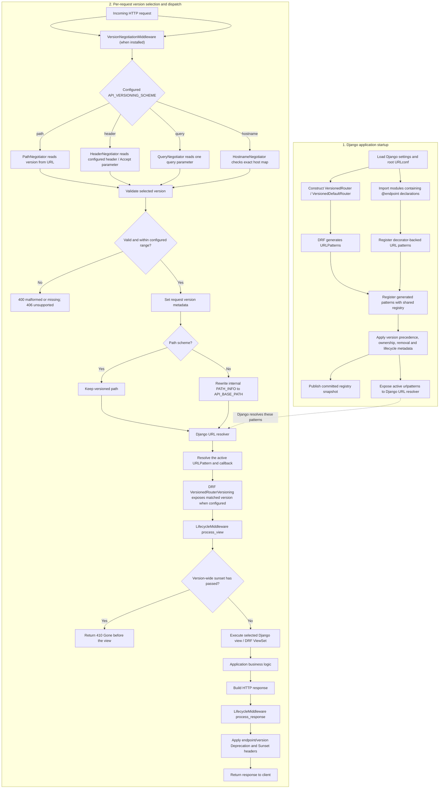

# Runtime architecture and request flow

This document describes how the package turns endpoint declarations into Django URL patterns, selects an API version for each request, dispatches the matching implementation, and applies lifecycle policy.

The diagram is maintained as Mermaid source in this Markdown file. GitHub renders it directly; keeping the source beside the implementation makes architectural changes reviewable in pull requests.

## End-to-end flow

## 1. Startup and registration

The package uses one registry for decorator-backed Django views and optional DRF router integrations.

- Importing a module containing `@endpoint` declarations registers the corresponding Django URL patterns.
- `VersionedRouter` delegates route generation to DRF's `SimpleRouter`; `VersionedDefaultRouter` adds a version-specific API root and optional format-suffix patterns. Both register the generated patterns with the same registry.
- The registry tracks concrete route versions, source versions, logical endpoint identity, router ownership, explicit removals, and endpoint lifecycle metadata.
- Registration precedence and forward inheritance determine which callback is active for each concrete version. A later source declaration replaces only the matching logical route; unchanged routes remain inherited. Explicit removals suppress a route from their inclusive version boundary unless a later declaration reintroduces it.
- Mutations are synchronized and transaction-aware. A committed state publishes an immutable registry snapshot for internal resolution and lifecycle operations; Django receives the active URL patterns through the package's URL configuration.

Import endpoint modules before including the package's generated URL patterns. Route settings that shape registration must be configured before those imports.

## 2. Request version negotiation

`VersionNegotiationMiddleware` is optional. The default `path` scheme preserves the established versioned URL behavior. A deployment selects exactly one scheme through `API_VERSIONING_SCHEME`:

| Scheme | Version source | Example |
| --- | --- | --- |
| `path` | URL path | `/api/v2/orders/` |
| `header` | Configured version header or DRF Accept media parameter | `Accept-Version: 2` |
| `query` | One configured query parameter | `/api/orders/?version=2` |
| `hostname` | Exact configured hostname-to-version mapping | `v2.api.example.com` |

The four negotiators own transport-specific parsing. The middleware remains the orchestration boundary: it validates the selected version against the configured range, exposes `request.requested_api_version`, `request.api_version`, and `request.version`, and dispatches the request.

For non-path schemes, only requests below `API_UNVERSIONED_BASE_PATH` are rewritten. The middleware updates Django's internal `PATH_INFO` / `path_info` before URL resolution; it does not redirect the client or create a second router. Header mode adds the relevant `Vary` fields. Query and hostname cache-key policy remains a deployment responsibility.

Install this middleware before middleware that depends on the resolved path, including `CommonMiddleware` and `LifecycleMiddleware`.

## 3. URL resolution and implementation selection

After negotiation, Django's ordinary URL resolver matches the generated URL patterns. The package does not select a "nearest" or "latest" implementation when a requested endpoint is absent:

- malformed or missing required negotiation values return `400 Bad Request`;
- globally unsupported versions and unmapped hostnames return `406 Not Acceptable`;
- a valid version with no registered route returns `404 Not Found`;
- a matching route invokes its registered Django view or DRF ViewSet action.

For DRF ViewSets, `VersionedRouterVersioning` can expose the concrete router namespace as `request.version` and preserve version-aware reversal. It is an adapter to DRF's versioning interface, not a second route resolver.

## 4. Lifecycle processing

When installed, `LifecycleMiddleware` applies lifecycle policy around the resolved view:

1. Its `process_view` hook checks version-wide sunset policy after URL resolution and can return `410 Gone` before the selected view executes.
2. After normal view execution, `process_response` applies version-level and endpoint-level `Deprecation` and `Sunset` headers where configured.
3. Endpoint lifecycle metadata is resolved against the actual matched operation. It does not silently retire the whole API version.

Middleware ordering matters: version negotiation must run before lifecycle processing so the lifecycle layer sees the effective version and resolved path.

## 5. Responsibility boundary

This package chooses which registered implementation handles a request and provides route/lifecycle governance. It does not transform serializers or response payloads, guarantee semantic compatibility between API versions, authenticate tenants, or define CDN cache keys. Those remain application and deployment responsibilities. Use consumer-owned request tests and OpenAPI contracts to verify response semantics.

## Related contracts

- [Canonical versioning and routing contract](../reference/versioning-contract.md)
- [Request version negotiation](request-version-negotiation.md)
- [Versioned DRF router design](versioned-drf-router.md)
- [Endpoint lifecycle design](endpoint-lifecycle.md)
- [API compatibility boundaries](api-compatibility-boundaries.md)
- [Quality and release gates](../quality/release-gates.md)
